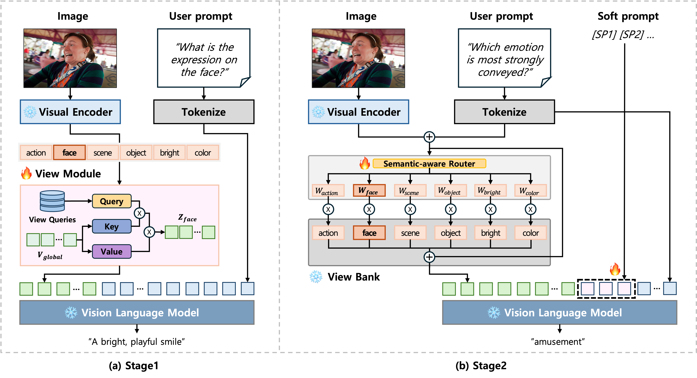

# SAVER: Semantic-Aware Multi-View Emotion Reasoning in Vision-Language Models

<p align="center">
  
</p>


## 🔍 Overview

SAVER is a selective and adaptive multi-view emotion reasoning framework built upon frozen vision-language models (VLMs).

Unlike conventional visual emotion analysis methods that rely on global visual representations, SAVER explicitly disentangles diverse emotion-related visual cues into multiple semantic views and selectively integrates them through semantic-aware routing and mixture-of-experts fusion.

The framework consists of two stages:

- **Stage 1:** View-specific representation learning
- **Stage 2:** Selective multi-view routing and reasoning

SAVER is implemented on top of Qwen2-VL and introduces modular routing, fusion, and vision-token replacement mechanisms for efficient emotion reasoning without fine-tuning the entire VLM.


## 📦 Setup

```bash
cd SAVER

conda create -n saver python=3.10
conda activate saver

pip install -r requirements.txt
```


## 📂 Repository Structure

```bash
SAVER/
│
├── main.py
├── config.py
├── data.py
├── trainer.py
├── evaluator.py
│
├── configs/
│   ├── train.yaml
│   └── eval.yaml
│
├── models/
│   ├── saver.py
│   ├── modules.py
│   └── utils.py
│
├── prompts/
├── outputs/
└── README.md
```


## 📂 Dataset Structure

The project assumes the following dataset directory layout.

Example: EmoSet

```bash
emoset/
├── train/
│   ├── amusement/
│   ├── anger/
│   └── ...
│
├── test/
│   ├── amusement/
│   ├── anger/
│   └── ...
│
└── annotation/
    ├── amusement/
    ├── anger/
    └── ...
```

- Each emotion label corresponds to a subfolder.
- For datasets with annotation files (e.g., EmoSet), JSON annotations should follow the same hierarchy as the image folders.
- Some datasets (e.g., Emotion6) may not contain annotation files and only include train/test splits.
- Update dataset paths in `configs/train.yaml` and `configs/eval.yaml` before training or evaluation.


## 🧠 Multi-View Prompt Configuration

View-specific prompts are stored under:

```bash
prompts/
```

Each semantic view contains multiple prompt templates used during training.

Example semantic views:

- scene
- object
- facial_expression
- human_action
- color
- brightness


## 🧪 Training

SAVER training consists of two stages.

All training configurations can be modified in:

```bash
configs/train.yaml
```


### 1️⃣ Stage 1 — View-Specific Representation Learning

Train view-specific view prompts and cross-attention modules.

```bash
CUDA_VISIBLE_DEVICES=0 python main.py --stage stage1
```

After training, the learned routing-related modules are saved automatically.


### 2️⃣ Stage 2 — Semantic-Aware Multi-View Fusion

Load Stage 1 weights and train semantic-aware selective routing and fusion modules.

```bash
CUDA_VISIBLE_DEVICES=0 python main.py --stage stage2
```


## 📈 Evaluation

Evaluate the trained SAVER model using:

```bash
CUDA_VISIBLE_DEVICES=0 python evaluator.py
```

All evaluation configurations can be modified in:

```bash
configs/eval.yaml
```

